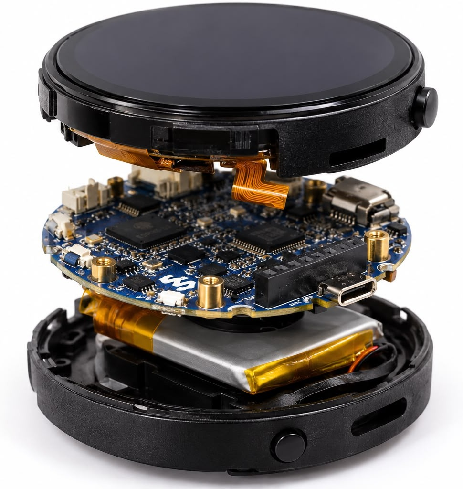
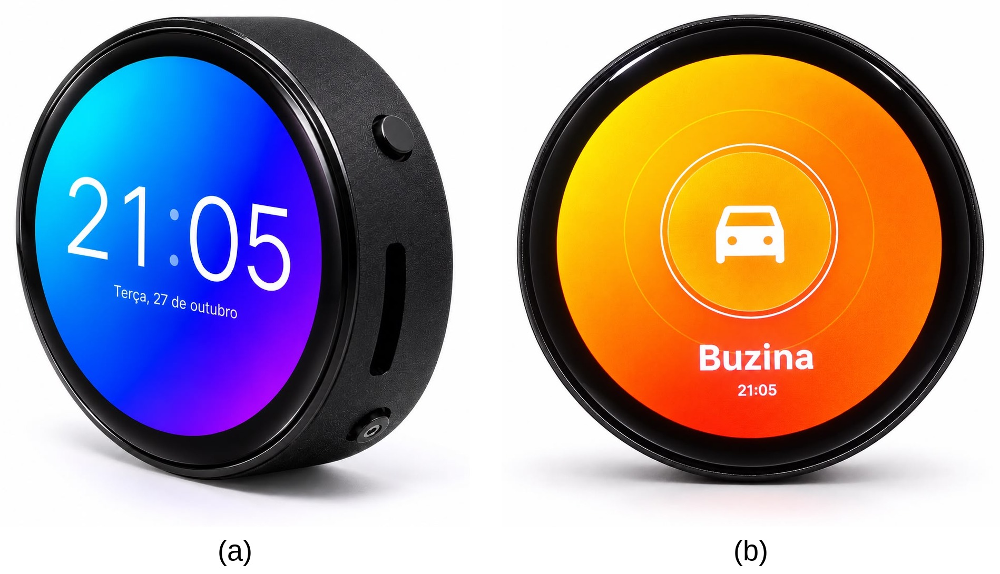
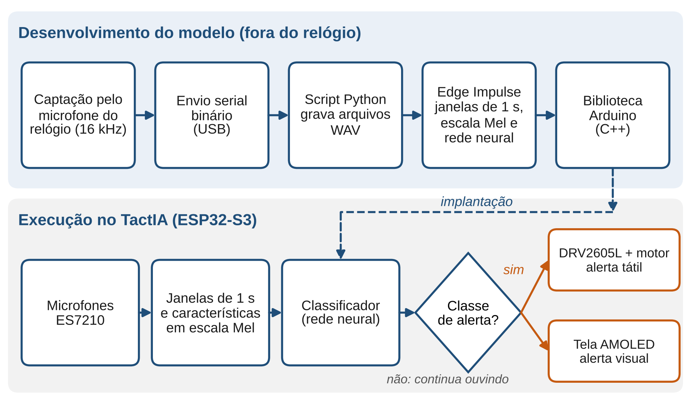
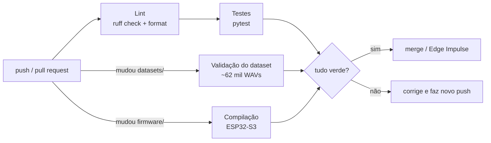
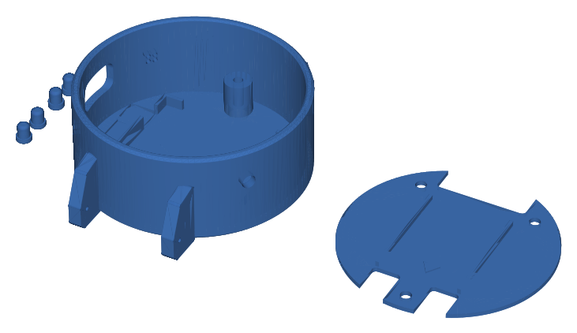

<p align="center">
  
</p>

<p align="center">
  <a href="https://github.com/TactIA/tactia/actions/workflows/ci.yml"></a>
  <a href="https://github.com/TactIA/tactia/actions/workflows/dataset.yml"></a>
  <a href="https://github.com/TactIA/tactia/actions/workflows/firmware.yml"></a>
</p>

O **TactIA** é um smartwatch assistivo com inteligência artificial embarcada, desenvolvido para pessoas com deficiência auditiva severa ou profunda. O relógio detecta e classifica sons relevantes do ambiente, como buzinas, campainhas, sirenes e alarmes, e avisa o usuário por padrões de vibração no pulso e por um alerta na tela. Tudo roda no próprio ESP32-S3, sem internet e sem enviar áudio para fora do aparelho.

Projeto Integrador 2026, com metodologia aplicada e experimental e desenvolvimento iterativo de hardware e software.

<p align="center">
  
  &nbsp;&nbsp;
  
</p>
<p align="center"><sub>Renderizações do design proposto: vista explodida e as duas telas principais (repouso e alerta de buzina).</sub></p>

## Problema

Segundo a **Organização Mundial da Saúde (OMS)**, mais de 1,5 bilhão de pessoas vivem com algum grau de perda auditiva no mundo. No Brasil, o Censo Demográfico do IBGE aponta que aproximadamente **10,7 milhões de pessoas** possuem deficiência auditiva, cerca de 5% da população.

As soluções existentes têm limitações importantes:

- **Aparelhos auditivos** amplificam sons indiscriminadamente, sem classificá-los por relevância;
- **Aplicativos de smartphone** exigem que o usuário esteja olhando para a tela.

O TactIA preenche essa lacuna com um dispositivo vestível compacto, de baixo custo, com IA local e resposta háptica imediata.

## Alinhamento com os ODS da ONU

- **ODS 10 – Redução das Desigualdades**: inclusão social de pessoas com deficiência auditiva;
- **ODS 3 – Saúde e Bem-Estar**: mais segurança e qualidade de vida para o público-alvo.

## Benchmarking

| Solução | Descrição | Limitação |
|---|---|---|
| Starkey Livio AI | Aparelho auditivo com IA | Custo acima de R$ 8.000; foco em amplificação, não em classificação |
| Bellman & Symfon | Sistema de alertas visuais residenciais | Limitado ao ambiente doméstico, sem mobilidade |
| Sound Alert (app) | App de detecção de sons com notificações visuais | Exige tela ativa; sem feedback háptico dedicado |
| **TactIA ✓** | **Smartwatch com IA embarcada, vibração háptica e alertas visuais** | **Protótipo em desenvolvimento** |

## Arquitetura

<p align="center">
  
</p>

O fluxo de cima roda fora do relógio: o áudio é captado pelo próprio microfone do dispositivo, vai pela USB até o computador, vira WAV, é treinado no Edge Impulse e volta como biblioteca C++. O fluxo de baixo roda inteiro no ESP32-S3: o som é dividido em janelas de 1 s, convertido em características na escala Mel e classificado. Quando a classe é um alerta, o firmware aciona o motor e muda a tela.

### Hardware

A base é a **placa Waveshare ESP32-S3-Touch-AMOLED-1.75**, com:

- microcontrolador **ESP32-S3 dual-core**, que executa o modelo localmente;
- tela **AMOLED tátil circular** de 1,75" (466×466 px);
- gerenciamento de energia **AXP2101**;
- dois microfones ligados ao ADC **ES7210** e codec **ES8311**.

Completam o conjunto o **driver háptico DRV2605L** (I²C), o micromotor de vibração, uma **bateria Li-Po 3,7 V** e a **carcaça impressa em 3D** (`hardware/carcaca`).

### Software e IA

| Camada | Tecnologia |
|---|---|
| Firmware | C/C++ (Arduino, núcleo ESP32 3.x) |
| Interface | LVGL |
| Modelo | Edge Impulse: janelas de 1 s, MFE (escala Mel) e rede neural; deploy float32 |
| Dados | Gravações reais do relógio + áudio público com o microfone do relógio simulado (`ml/`) |
| Integração contínua | GitHub Actions: ruff, pytest, validação do dataset e compilação do firmware |
| Carcaça | Modelagem 3D, impressão em PETG |

Classes: `alarme`, `ambiente` (sem alerta), `buzina`, `campainha` e `sirene`.

## Integração contínua

Todo push e todo pull request na `main` passa pelo pipeline abaixo no GitHub Actions. Os jobs de dataset e de firmware só rodam quando aquela parte do repositório muda, pra manter o ciclo rápido.



O que cada etapa protege:

- **Lint**: `ruff check` e `ruff format --check` no código Python (`ml/`, `tests/`, `tools/`).
- **Testes**: 72 testes em `tests/`, cobrindo:
  - o simulador do microfone, com piso de ruído igual ao medido no relógio, saturação e resposta ao nível;
  - os sintetizadores: saída válida, energia dentro da banda de 16 kHz e reprodutibilidade;
  - o validador de dataset;
  - os **contratos entre firmware e script**: baud rate da captura igual ao do `captura_audio.py`, taxa de amostragem igual nos três e `gainVal` igual na captura e na inferência. Foram exatamente essas diferenças que já corromperam gravações antes.
- **Validação do dataset**: confere o `info.labels`, se cada WAV é 16 kHz mono PCM16, se o nome do arquivo bate com o rótulo, se sobrou WAV fora da lista e se alguma gravação está em treino e teste ao mesmo tempo. O resumo aparece na página da execução.
- **Firmware**: compila o sketch de captura para `esp32:esp32:esp32s3` com o `arduino/compile-sketches`.

Pra rodar o mesmo localmente:

```bash
pip install -r requirements-dev.txt
ruff check ml tests tools && ruff format --check ml tests tools
pytest
python ml/validar_dataset.py datasets
```

## Dados

| conjunto | amostras | uso |
|---|---:|---|
| `datasets/relogio` | 1.240 | gravações reais pelo microfone do relógio; a sessão `validacao` é o teste |
| `datasets/publico_simulado_v3` | 60.801 | AudioSet, ESC-50, LibriVox, MS-SNSD e síntese física, passados pela cadeia de captação do relógio |

A pasta `datasets/` já está pronta pro upload no Edge Impulse, com um `info.labels` único. O passo a passo está em [`datasets/README.md`](datasets/README.md).

A simulação do microfone foi calibrada com gravações de silêncio do relógio, que mostraram:

- piso de −69 dBFS;
- zumbido em ~54 Hz e tons elétricos em 6 e 7 kHz;
- ressonância de +5 a +10 dB entre 6 e 7 kHz.

Num teste com um modelo de referência treinado só com dados gerados, o acerto nas gravações reais do relógio foi de 56% (simulação genérica) para 65% (simulação calibrada). Detalhes em [`ml/README.md`](ml/README.md).

## Resultados

| etapa | conjunto de teste | acerto |
|---|---|---:|
| Modelo do artigo EnGeTec (int8) | divisão automática 80/20 do Edge Impulse | 89,23% |
| Dataset limpo, teste só com a sessão `validacao` | gravações do relógio nunca vistas | 80,14% |
| Teste no relógio por injeção, deploy int8 (ESP-NN) | sessão `validacao` | 10,5% |
| Teste no relógio por injeção, deploy float32 | sessão `validacao` | 78,3% |

Duas lições ficaram registradas no histórico:

- A divisão automática por janela inflava o resultado: janelas da mesma gravação caíam em treino e teste. Por isso o teste agora é só a sessão `validacao`, e o CI barra qualquer vazamento.
- No relógio, o modelo só reproduz o Studio em float32.

## Carcaça 3D

<p align="center">
  
</p>

`hardware/carcaca/placa_impressao_PETG.stl` traz as peças da carcaça na posição de impressão, em PETG: corpo, tampa traseira e botões. O próprio GitHub mostra o STL em 3D.

## Casos de uso

| Som detectado | Padrão de vibração | Tela |
|---|---|---|
| 🚗 Buzina de veículo | Três vibrações intensas | Ícone de buzina |
| 🔔 Campainha | Vibrações curtas pulsadas | Ícone animado |
| 🚨 Sirene de emergência | Vibração contínua de alerta máximo | Alerta visual de emergência |
| 🔕 Modo silencioso | Vibrações desativadas | Configuração via toque |

No firmware atual o motor está desativado até o hardware háptico ser montado; por enquanto o alerta sai pela tela e pela Serial.

## Estrutura do repositório

```
tactia/
├── .github/workflows/   CI: ci.yml (lint + testes), dataset.yml, firmware.yml
├── firmware/
│   ├── captura/         sketch que só grava áudio cru pela serial (dataset)
│   └── inferencia/      sketch de produção: roda o modelo e dispara os alertas
├── tools/               captura_audio.py: recebe o áudio da serial e salva WAV
├── ml/                  simulador do microfone, sintetizadores, pipeline e validador
├── tests/               testes automatizados (pytest)
├── datasets/            dados prontos para o Edge Impulse (info.labels único)
├── hardware/carcaca/    modelo 3D da carcaça (STL)
└── docs/                artigo EnGeTec 2026 e imagens
```

A biblioteca exportada do Edge Impulse não é versionada (`model/` está no `.gitignore`).

## Cronograma

| Período | Atividade |
|---|---|
| Janeiro – Fevereiro | Revisão bibliográfica e importação do hardware |
| Março – Abril | Integração do driver DRV2605L, LVGL e interface gráfica básica |
| Maio – Junho | Coleta de áudio, treinamento e compilação do modelo no Edge Impulse |
| Julho – Agosto | Modelagem e impressão da carcaça 3D, montagem compacta |
| Setembro – Outubro | Testes de campo e validação de usabilidade com o público-alvo (escala SUS) |
| Novembro – Dezembro | Refinamentos finais, documentação e apresentação na FETEPS |

## Orçamento

| Componente | Custo |
|---|---|
| Placa Waveshare ESP32-S3-Touch-AMOLED-1.75" | R$ 300,00 |
| Módulo driver háptico DRV2605L | R$ 40,00 |
| Bateria Li-Po 3,7 V (400 mAh) com conector JST | R$ 35,00 |
| Micromotor de vibração | R$ 10,00 |
| Fiação e insumos de impressão 3D | R$ 20,00 |
| **Total** | **R$ 405,00** |

O desenvolvimento está estimado em **280 horas**:

- programação de interface: 50 h;
- integração e drivers: 30 h;
- treinamento de IA: 60 h;
- modelagem 3D: 30 h;
- testes: 60 h;
- documentação: 50 h.

## Artigo

O artigo submetido ao EnGeTec 2026 está em [`docs/artigo/TactIA_EnGeTec2026_PT.docx`](docs/artigo/TactIA_EnGeTec2026_PT.docx).

## Stakeholders

- **Usuários primários**: pessoas com deficiência auditiva severa ou profunda;
- **Familiares e cuidadores**: beneficiados pela maior autonomia e segurança dos usuários;
- **Associações e instituições de apoio a surdos**: potenciais parceiros de validação;
- **Equipe de desenvolvimento**: integração de hardware, design 3D, firmware e IA.

## Equipe

Diogo, Guilherme, Ricardo e Vinicius.

## Contribuindo

Veja o [`CONTRIBUTING.md`](CONTRIBUTING.md) (branches, padrão de commits e o que o CI exige) e o [`CHANGELOG.md`](CHANGELOG.md). Dúvidas e sugestões pelas _issues_ deste repositório.
