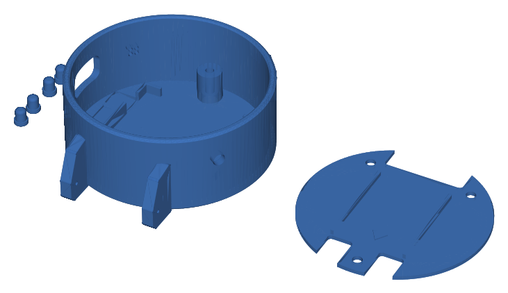

# Carcaça 3D

`placa_impressao_PETG.stl` traz as peças da carcaça já posicionadas na mesa de impressão: corpo cilíndrico com as abas da pulseira, tampa traseira e três botões. O conjunto ocupa cerca de 126 × 64 × 22 mm e foi pensado para impressão em PETG.

O GitHub abre o arquivo num visualizador 3D: é só clicar no `.stl`.

